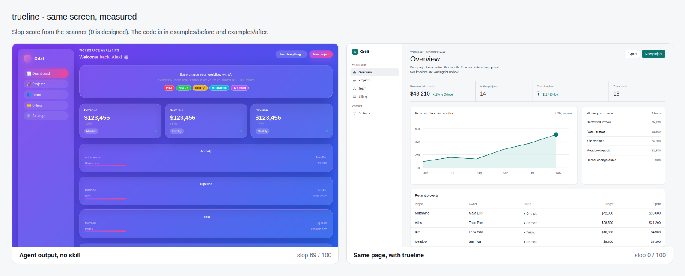
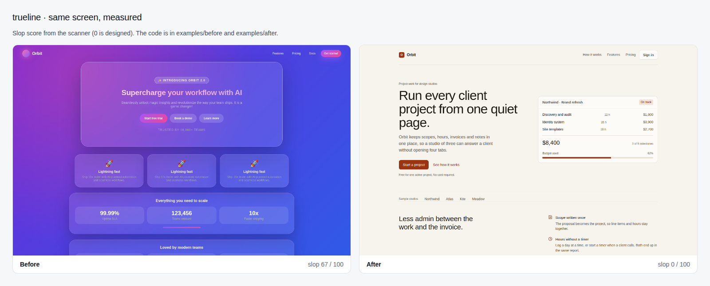
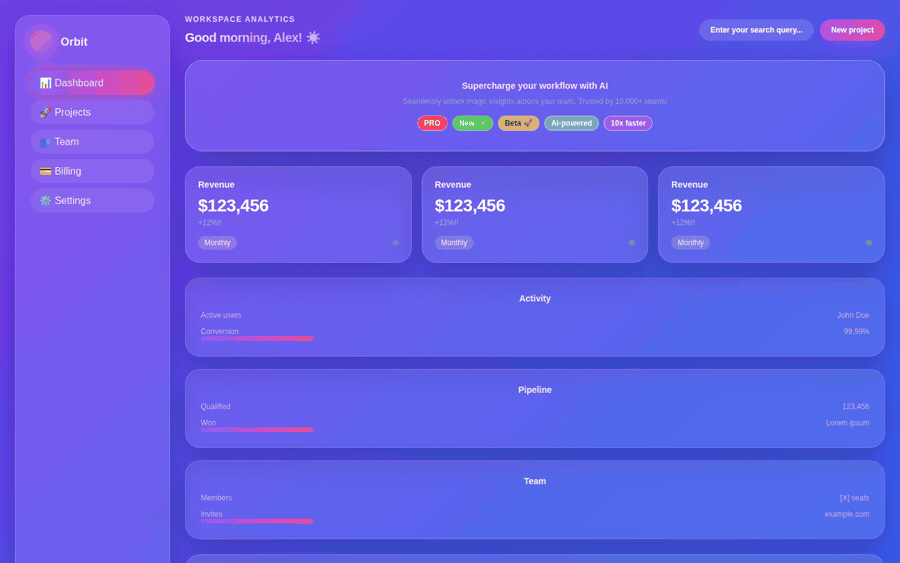

# trueline

AI-looking UI in, designed UI out — with two numbers to prove it.

```bash
npx skills add terravidhal/trueline --skill trueline
```

Works with Claude Code, Codex, Cursor, Gemini CLI, GitHub Copilot, OpenCode and
any agent that reads `SKILL.md`. Node 22+ for the scanner and the report;
Playwright/Chromium for computed styles and captures.



## What it does

- **Scores** an HTML page, a live URL or a PNG screenshot on a deterministic
  0–100 slop scale, with a selector and a value for every signal. No model, no
  network call.
- **Fixes the real code** in nine ordered passes, from spacing to motion.
- **Re-scans after every pass** and writes a ledger of file, selector, before →
  after, and the signal each edit targets.
- **Reports** the before/after score, the per-category delta, what remains and
  any waiver with its reason.

The score is the point. Advice is cheap; a lower number on the same rubric,
explained edit by edit, is checkable.

### The two proofs

1. **Before and after, same rubric.** Not an opinion, not a vibe: `slop 69 → 0`,
   per category, with the selector and the measured value behind every point.
2. **The real code changed.** Nine ordered passes, a re-scan after each one, and
   a ledger that maps every edit to a file, a selector, a signal and a delta.
   You can review the diff and re-run the scan yourself.

## See it

| Screen | Before | After |
|---|---:|---:|
| Dashboard, computed DOM | 69 | 0 |
| Landing, computed DOM | 67 | 0 |
| Pricing, computed DOM | 64 | 0 |
| New-project form, computed DOM | 54 | 0 |





The four screens are in [`examples/before/`](examples/before/) and
[`examples/after/`](examples/after/). Each has a change ledger
(`examples/passes*.json`) and a generated report: the dashboard is in
[`RAPPORT.md`](RAPPORT.md), all four are under
[`examples/reports/`](examples/reports/). Each page is captured at 1440 and 390,
light and dark, in [`assets/readme/`](assets/readme/). Open the raw scans:

```bash
node skills/trueline/scripts/scan.mjs examples/before/dashboard.html
node skills/trueline/scripts/scan.mjs examples/after/dashboard.html \
  --compare examples/reports/dashboard-before.json
node skills/trueline/scripts/scan.mjs examples/after/pricing.html \
  --compare examples/reports/pricing-before.json
```

## Install

| Agent | One line |
|---|---|
| Claude Code | `npx skills add terravidhal/trueline --skill trueline -a claude-code` |
| Codex | `npx skills add terravidhal/trueline --skill trueline -a codex` |
| Cursor | `npx skills add terravidhal/trueline --skill trueline -a cursor` |
| Gemini CLI | `npx skills add terravidhal/trueline --skill trueline -a gemini-cli` |
| GitHub Copilot | `npx skills add terravidhal/trueline --skill trueline -a github-copilot` |
| OpenCode | `npx skills add terravidhal/trueline --skill trueline -a opencode` |

Add `-g` for every project, `--copy` to write files, `--list` to preview. The
skill installs as one folder: `SKILL.md`, seven references, three scripts and a
demo page.

Manual copy:

```bash
cp -r skills/trueline ~/.claude/skills/trueline          # Claude Code
cp -r skills/trueline ~/.agents/skills/trueline          # Codex
cp -r skills/trueline ~/.config/opencode/skills/trueline # OpenCode
```

## Use

Audit only:

> Score this page and tell me why it looks generated. Do not edit anything.

Fix it:

> Unslop this dashboard. Fix the real code, re-score after each pass, and leave a
> report with the before and after.

Screenshot only:

> Here is a PNG of our checkout. Rate it and list what to change.

Live URL:

```bash
node skills/trueline/scripts/capture.mjs https://example.com trueline/original.html \
  --png trueline/before.png --theme light
node skills/trueline/scripts/scan.mjs trueline/original.html --json trueline/before.json
```

The agent follows the thresholds: **45+** full correction, **20–44** polish,
**0–19** do not redesign — offer at most three exact refinements.

## The score

`slop = round(Σ weight × severity)`, category caps, weights sum to 100. Rubric `1`.

| Category | Signals | Max |
|---|---|---:|
| Colour | purple/blue gradients, gradient text, glow, glass, soft shadow everywhere, neon border, hue chaos | 30 |
| Layout | identical cards, three equal columns, centered stacked hero, uniform rhythm, everything a pill | 20 |
| Type | flat hierarchy, too many variants, uppercase tracking, tiny body, negative tracking | 15 |
| Copy | emoji, hype and greetings, fake data, wordy labels | 15 |
| Contrast | body, meta, focus and targets | 10 |
| Motion | infinite decoration, `transition-all`, animated layout | 10 |

Output is stable JSON with `slop`, `design`, six category scores, and for each
signal an id, name, weight, severity, penalty, evidence and measured values. See
[`references/scoring.md`](skills/trueline/references/scoring.md) for the full
schema, waivers and anti-gaming rules.

Modes and confidence:

| Mode | Confidence | Use |
|---|---:|---|
| computed DOM (Playwright) | 1.0 | the reference; any real project |
| static HTML + CSS | 0.55 | CI, locked machines, no browser |
| PNG image | 0.45 | colour and softness only; last resort |

## What it will not do

- Invent a feature, a claim, a customer or a metric.
- Hide an element to make the score look better; hiding is reported.
- Replace one trend with another (glass, grain, neon, bento).
- Redraw a logo, rename a product, or bypass accessibility for points.
- Call a paid service, send the page anywhere, or install a dependency without
  asking.
- Promise that a score of 0 is "beautiful". It means the measurable slop is gone;
  the direction still has to be right.

## Repository

```text
skills/trueline/          SKILL.md, references/, scripts/, assets/
examples/before|after/    four screens, same content, corrected
examples/passes-*.json    per-screen change ledgers
examples/reports/         before/after JSON, report records and reports
assets/readme/            1440/390, light/dark captures with Chromium
assets/demo.gif           short before→after demo
evals/evals.json          prompt-level behaviour checks
scripts/check-skill.mjs   structure + deterministic evals (npm run lint)
```

Maintainer checks:

```bash
npm run lint          # structure, links, JSON, assets, scanner evals
npm run lint:evals    # the same plus contrast, waivers, hiding, report, image
npm run lint:assets   # 32 captures, before/after sheets and demo.gif
```

`npm run lint` needs no browser. Regenerate the screenshots only when the example
pages change.

## Limits

- The scanner measures observable signs, not taste. A zero score with a weak
  direction is still a weak screen; the direction reference exists for that.
- Static mode flattens media queries and cannot measure layout; use the DOM when
  it matters.
- A PNG loses selectors, copy and per-element contrast. Prefer the source.
- A deliberate gradient, a justified shadow or a centered short hero can be
  waived — with a selector, a reason and a cap of five.
- The rubric will age. It is versioned; two scans with different rubrics are
  refused rather than quietly compared.

## FAQ

**Does it edit React, Next.js, Vue, Svelte and Tailwind?**
Yes. The skill edits the source that renders the screen and follows the
project's conventions; the HTML examples are only fixtures.

**Do I need a browser?**
No for static HTML and the report. Playwright is optional and used for computed
styles, live URLs and PNG captures.

**Can I keep a deliberate gradient, shadow or centered hero?**
Yes. Declare a waiver with the signal id, the selector and a reason. It is shown
in the report, capped at five, and never lowers the score silently.

**Is the score a design review?**
No. It measures observable slop signals. A zero means the measurable slop is
gone, not that the direction is good; read the direction reference for that.

**Does it send my page anywhere?**
No telemetry and no model call. The scanner runs locally; `capture.mjs` fetches
only the URL you give it, with your browser.

**What if I only have a screenshot?**
Image mode scores colour and softness at confidence 0.45 and cannot return
selectors, copy or per-element contrast. Prefer the source when you have it.

## License

MIT for this repository. The examples, brand names and numbers are fictional. The
scanner, rubric, scripts, references and example pages were written for this
repository; no file, prose passage or image from another anti-slop skill is
reused. The nine-pass order and the five-line direction are a design method also
used by [`heydamir/unslop`](https://github.com/heydamir/unslop) (CC BY 4.0); that
project is not affiliated with this one.
